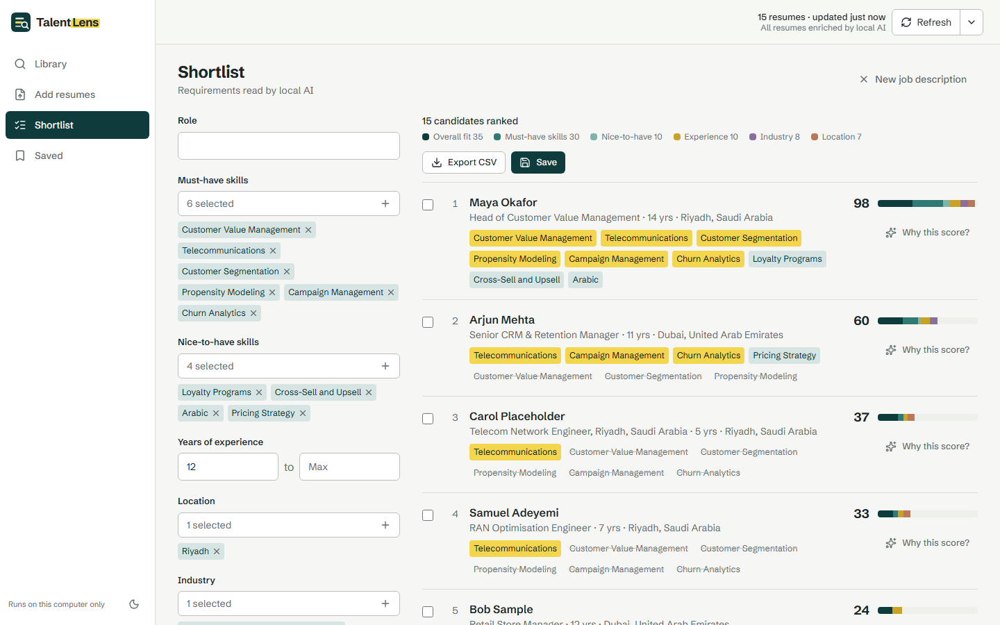
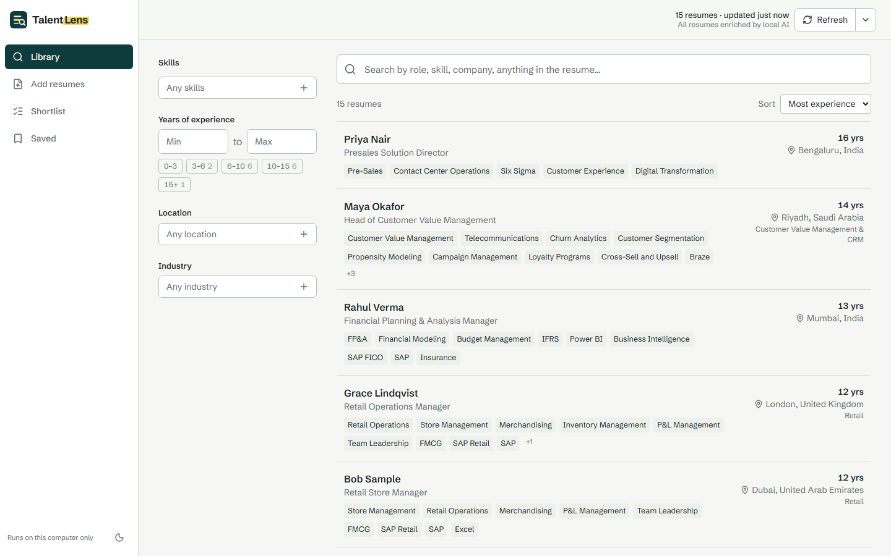
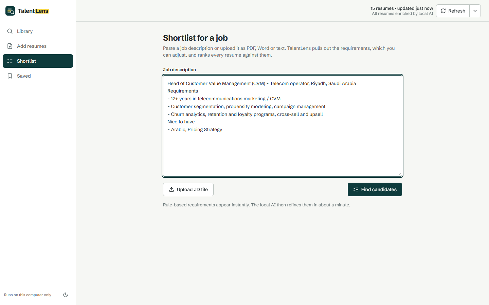
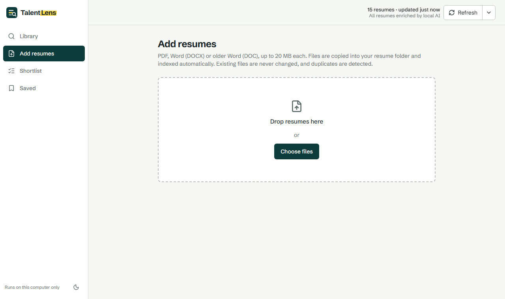
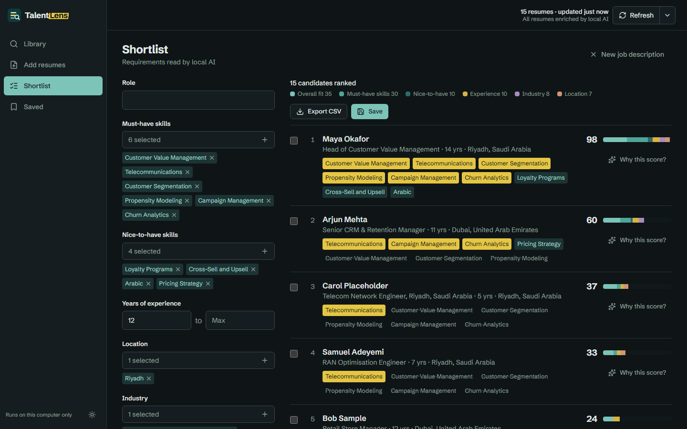
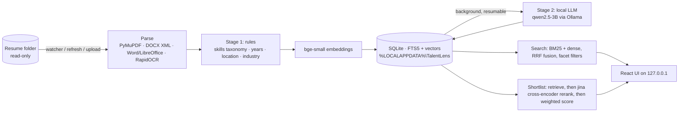

# TalentLens

TalentLens is a private resume library and job-description shortlisting tool. It runs entirely on your own computer.

- **Add resumes** (PDF, DOCX, DOC) by drag and drop. They are indexed automatically. Duplicates are detected and existing files are never changed.
- **Search and filter** by free text, skills (match all or any), years of experience, location and industry.
- **Shortlist for a job:** paste or upload a JD (PDF, DOCX, DOC, TXT). TalentLens extracts the requirements, which you can edit, and ranks every resume with a transparent score.
- **Explanations, saved shortlists and CSV export.**
- **Fully local and free:** OCR, embeddings, reranking and the LLM all run on your laptop. No data leaves your machine, and it works offline once set up.

## Screenshots

> These screenshots use **fictional demo resumes** (`backend/tests/demo_data.py`); no real candidate data is shown.

**Shortlist for a job.** Requirements are pulled from the JD and are editable. Every candidate gets a score bar split into its six parts. Must-haves that were found are highlighted; missing ones are struck through.



| Search and filter the library | Resume details |
| --- | --- |
|  |  |
| **Library sorted by experience** | **Paste or upload a job description** |
|  |  |
| **Add resumes (drag and drop)** | **Dark mode** |
|  |  |

To regenerate the screenshots: start the demo instance with `uv run python backend/tests/e2e_server.py --demo --root %TEMP%\tl-demo --port 8797`, then run `scripts/readme_screenshots.mjs`.

---

## Quick start (Windows)

```powershell
git clone https://github.com/punosie/talentlens.git C:\dev\talentlens
cd C:\dev\talentlens
powershell -ExecutionPolicy Bypass -File scripts\setup.ps1
```

Then double-click **TalentLens** on your desktop. The browser opens at <http://127.0.0.1:8765>.

`setup.ps1` is safe to run again at any time. It:

1. installs any missing tools with `winget`: [uv](https://docs.astral.sh/uv/) (Python manager), Node.js LTS and [Ollama](https://ollama.com),
2. installs Python 3.12 plus the backend dependencies (`uv sync`), and builds the web UI,
3. downloads the local models once: `qwen2.5:3b-instruct` (about 2 GB), the embedding, reranker and OCR models (about 300 MB),
4. installs the Playwright test browser,
5. creates the Desktop and Start-menu shortcuts.

| Option | Effect |
| --- | --- |
| `-CvDir "D:\Recruiting\CVs"` | Use another resume folder. This writes a new `.env`; an existing `.env` is never modified. |
| `-NoAI` | Skip Ollama. Extraction then uses rules only and everything else works. |
| `-WithLibreOffice` | Install LibreOffice to read legacy `.doc` files. Not needed if Microsoft Word is installed. |
| `-SkipTests` / `-NoShortcut` | Skip the test browser or the shortcuts. |

Other scripts: `scripts\start.ps1` (start and open), `scripts\stop.ps1` (stop the server), `scripts\install-shortcut.ps1`.

**Requirements:** Windows 10/11, 8 GB RAM minimum (16 GB recommended), and about 4 GB of disk. A GPU is not needed.

---

## How it works



**Two-stage indexing.** Stage 1 (parsing, rule-based fields and embeddings) takes about 1 s per resume. The whole library becomes searchable within minutes. Stage 2 runs the local LLM over each resume in the background, newest first, to improve names, titles, skills, experience and summaries. On a CPU-only laptop this takes about 1 minute per resume (about 4 hours for 200 resumes, once). The stage:

- pauses automatically while new uploads are indexed or while you use AI features,
- can be paused from the refresh menu,
- resumes where it left off.

**Shortlist score (0 to 100).** Every point is explained in the UI:

| Part | Weight | How it is measured |
| --- | --- | --- |
| Overall fit | 35 | Embedding similarity plus a cross-encoder rerank of the top 60 candidates |
| Must-have skills | 30 | Share of the required skills found in the resume |
| Nice-to-have skills | 10 | Share of the optional skills found |
| Experience | 10 | Within the required range gets full marks; partial credit near it |
| Industry | 8 | The resume's industries overlap the JD's |
| Location | 7 | Same city is full marks; same country is partial |

Several files for the same person (for example `CV.pdf` and `CV-1.pdf`) appear once, with the other files listed.

**Data safety rules.** These are enforced in code and covered by the tests:

- Existing resumes, `cv_index.csv`, `not_copied.csv` and `.env` are only ever read.
- Uploads are written with exclusive-create, so a file can never be overwritten. A name collision becomes `name (2).pdf`, and identical content is rejected as a duplicate.
- `.doc` conversion runs on a temporary copy, so no lock files appear in your folder.
- The app database, models and logs live in `%LOCALAPPDATA%\TalentLens`, outside OneDrive (syncing SQLite files corrupts them).
- The server only listens on `127.0.0.1`. Uploads are capped at 20 MB and checked by content (magic bytes), not just by extension.

---

## Configuration

Settings come from environment variables or an optional `.env` in the repo root. See [`.env.example`](.env.example).

| Variable | Default |
| --- | --- |
| `TALENTLENS_CV_DIR` | `%USERPROFILE%\OneDrive\Desktop\CVs\files` |
| `TALENTLENS_CV_INDEX_CSV` | `cv_index.csv` next to the CV folder, if present (shows where each CV came from) |
| `TALENTLENS_DATA_DIR` | `%LOCALAPPDATA%\TalentLens` |
| `TALENTLENS_PORT` | `8765` |
| `TALENTLENS_LLM` | `ollama` (`off` = rules only) |
| `TALENTLENS_OLLAMA_MODEL` | `qwen2.5:3b-instruct` (any Ollama model works; larger ones are better but slower) |
| `TALENTLENS_EMBED_MODEL` / `TALENTLENS_RERANK_MODEL` | `BAAI/bge-small-en-v1.5` / `jinaai/jina-reranker-v1-turbo-en` |

---

## Development

```powershell
uv run talentlens                    # API + built UI on :8765
cd frontend; npm run dev             # UI with hot reload on :5173 (proxies /api to :8765)

uv run pytest                        # backend tests (synthetic fixtures, mock AI)
uv run ruff check backend; uv run ruff format backend
cd frontend; npm run test:e2e        # Playwright: builds the UI, starts a fixture server, runs 22 specs
$env:TL_REAL_URL="http://127.0.0.1:8765"; npm run test:e2e:real   # smoke test against the real local LLM
```

Layout:

```
backend/talentlens/   FastAPI app: parsing/, ai/ (rules, LLM, embeddings, reranker, taxonomy data),
                      indexer, jobs (background queue + SSE), watcher, search, jd, shortlist, api/
backend/tests/        pytest suite + e2e_server.py (fixture server for Playwright)
frontend/             React 19 + Vite + Tailwind v4; e2e/ holds the Playwright specs
scripts/              setup / start / stop / shortcut (PowerShell)
.claude/skills/       frontend-design, webapp-testing (Anthropic) and talentlens-backend conventions
```

The skills taxonomy (`backend/talentlens/ai/data/skills.txt`), the industries list and the location list are plain text files that are easy to extend. Aliases map to canonical names; `=` marks case-sensitive aliases and `!` marks names that are only used for lookup.

## Troubleshooting

- **"Local AI offline" in the header:** start Ollama (it normally runs from the tray), or run `ollama pull qwen2.5:3b-instruct`. Everything else keeps working.
- **The app does not open:** see the logs in `%LOCALAPPDATA%\TalentLens\logs`, or run `uv run talentlens` in a terminal to see errors.
- **A `.doc` file is marked unreadable:** install Microsoft Word or LibreOffice (`setup.ps1 -WithLibreOffice`), then use *Full re-index*.
- **Start from scratch:** stop the app and delete `%LOCALAPPDATA%\TalentLens\talentlens.db*`. Your resumes are not affected.

## License

MIT. See [LICENSE](LICENSE).
