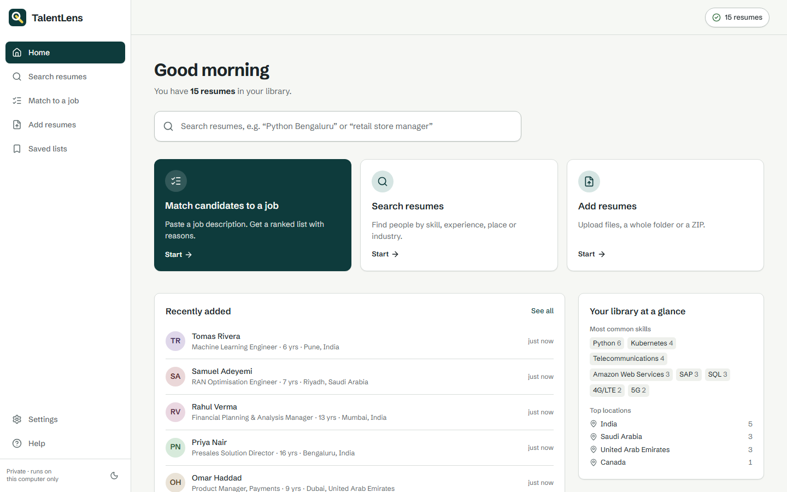
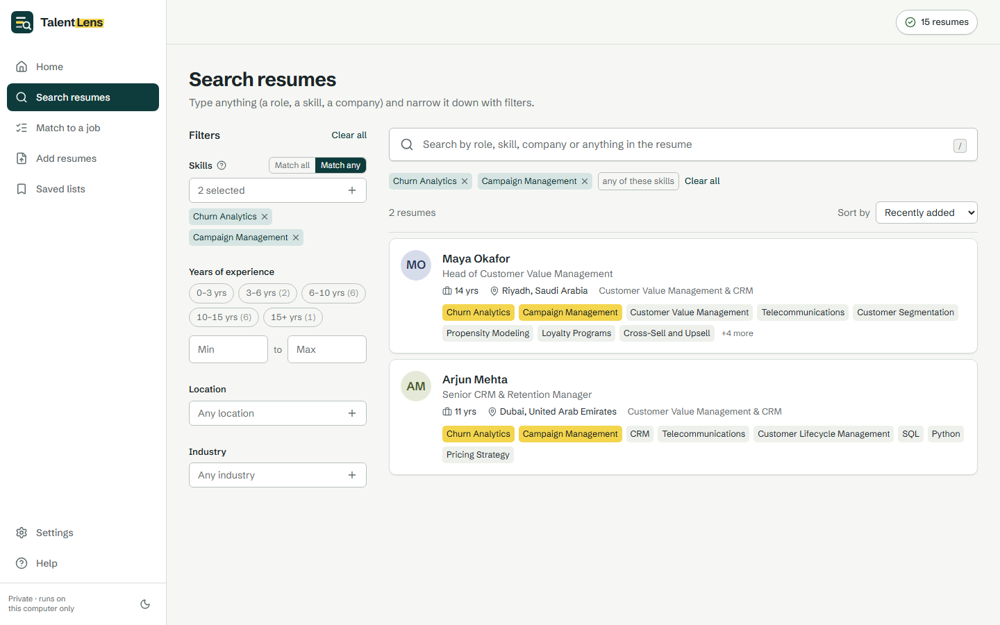
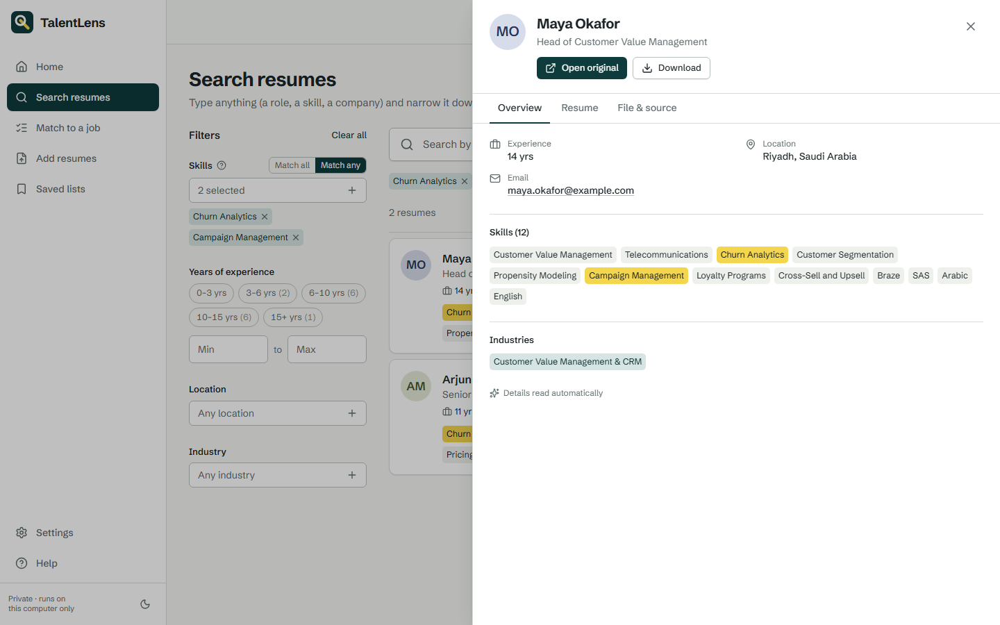
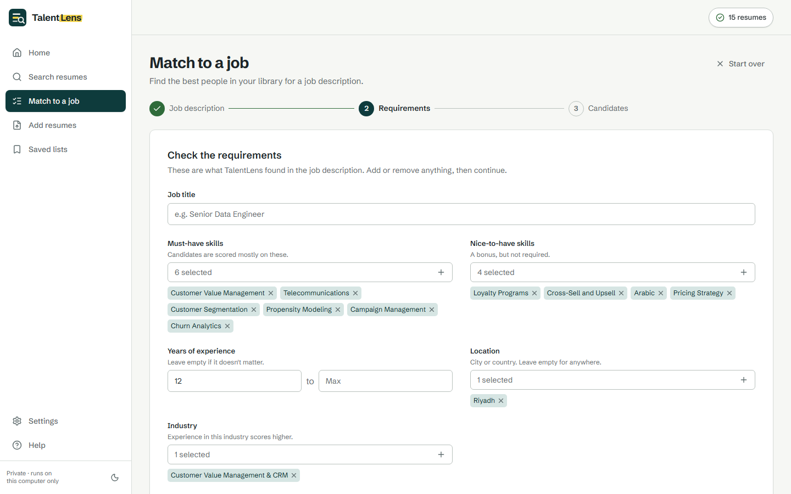
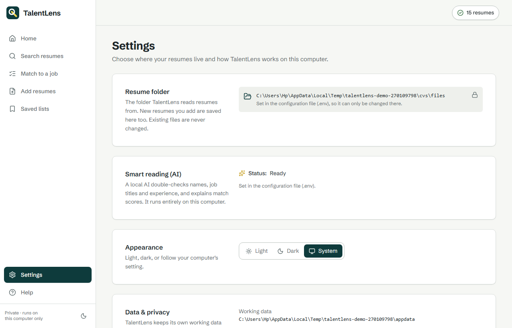
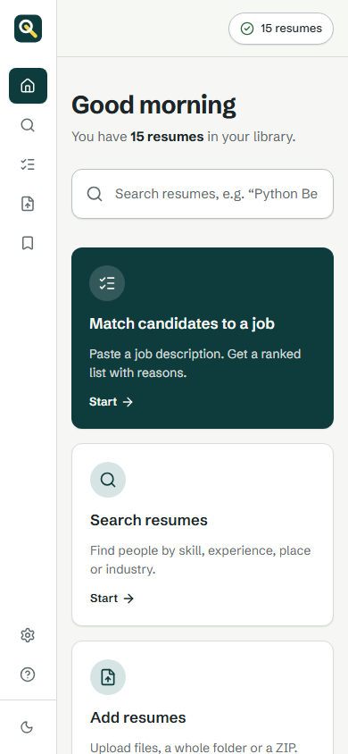
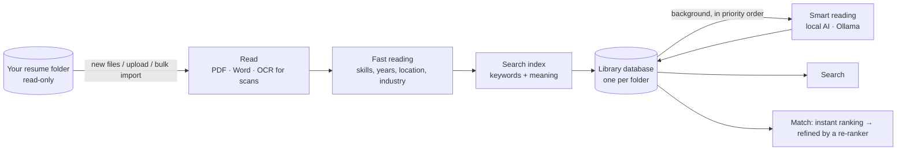

# TalentLens

TalentLens is a private resume library and job-matching tool. It runs entirely on your own computer, on Mac or Windows.

- **Add resumes in bulk:** pick files, a whole folder or a ZIP. They become searchable automatically. Duplicates are recognised and your existing files are never changed.
- **Search resumes:** type anything, then narrow by skills, years of experience, location and industry.
- **Match to a job:** paste or upload a job description. TalentLens reads the requirements, which you can adjust, and ranks every candidate with a clear match label, a one-line reason and a score breakdown. Save lists and export them to Excel (CSV).
- **Private by design:** OCR, search and the AI ("smart reading") all run on your computer. Nothing is uploaded, and it works offline once installed.

- **Your LinkedIn connections too (optional):** connect a MongoDB "connections database" in **Settings**. Your connections become searchable and matchable next to your resumes, each showing which LinkedIn account they're connected **via**. Resumes you add are saved back to the database, linked to the matching person when the CV contains their LinkedIn URL. Matching and AI still run on your computer; only the database lives in MongoDB.
- **Uses your NVIDIA GPU on Windows** for search embeddings and re-ranking when one is available (about 70× faster than the CPU for large imports), and falls back to the CPU automatically. Set `TALENTLENS_DEVICE=cpu` to force the CPU.


<sub>All screenshots use **fictional demo resumes** (`backend/tests/demo_data.py`); no real candidate data is shown.</sub>

| Home | Search with filters |
| --- | --- |
|  |  |
| **Candidate profile** | **Check the job requirements** |
|  |  |
| **Add resumes: files, a folder or a ZIP** | **Settings: choose your resume folder** |
|  |  |
| **Dark mode** | **On a phone-sized window** |
|  |  |

---

## Install on a Mac (Apple Silicon or Intel)

You need about 4 GB of free disk space and an internet connection for the first install only. Open **Terminal** (press ⌘ Space, type “Terminal”, press Enter) and paste these steps one at a time.

1. **Install Homebrew**, the standard Mac installer. Skip this if you already have it.
   ```bash
   /bin/bash -c "$(curl -fsSL https://raw.githubusercontent.com/Homebrew/install/HEAD/install.sh)"
   ```
   When it finishes, run the two `echo … >> ~/.zprofile` / `eval …` lines it prints under “Next steps”.

2. **Sign in to GitHub and download TalentLens.** The repository is private.
   ```bash
   brew install gh git
   gh auth login                     # choose GitHub.com → HTTPS → Login with a web browser
   gh repo clone punosie/talentlens ~/TalentLens
   ```

3. **Run the setup.** It takes 5–15 minutes the first time, mostly downloading the local AI.
   ```bash
   cd ~/TalentLens
   bash scripts/macos/setup.sh
   ```

4. **Open TalentLens** from **Launchpad** or **Spotlight** (search “TalentLens”). To keep it handy, right-click its Dock icon → *Options* → *Keep in Dock*.

The first time it opens, a short guide asks **where your resumes are**. Click **Browse…**, pick the folder and you're done. You can change it later in **Settings**.

<details><summary>Setup options</summary>

| Option | Effect |
| --- | --- |
| `--cv-dir ~/Desktop/CVs` | Set the resume folder now instead of in the app |
| `--no-ai` | Skip the local AI. Everything else still works. |
| `--with-libreoffice` | Install LibreOffice to read old `.doc` Word files |
| `--skip-tests` | Don't download the test browser |
| `--no-app` | Don't create the app in `~/Applications` |

Start or stop from Terminal: `bash scripts/macos/start.sh` / `bash scripts/macos/stop.sh`.
</details>

## Install on Windows 10/11

Open **PowerShell** and run:

```powershell
winget install --id GitHub.cli -e; winget install --id Git.Git -e
gh auth login
gh repo clone punosie/talentlens C:\dev\talentlens
cd C:\dev\talentlens
powershell -ExecutionPolicy Bypass -File scripts\setup.ps1
```

Then double-click **TalentLens** on your desktop (it's in the Start menu too). Setup options: `-CvDir "D:\CVs"`, `-NoAI`, `-WithLibreOffice`, `-SkipTests`, `-NoShortcut`. Start and stop with `scripts\start.ps1` / `scripts\stop.ps1`.

## Updating

```bash
cd ~/TalentLens && git pull && bash scripts/macos/setup.sh     # Mac
cd C:\dev\talentlens; git pull; powershell -ExecutionPolicy Bypass -File scripts\setup.ps1   # Windows
```

Your library, saved lists and settings are kept. Your resume files are never touched.

## Uninstalling

```bash
bash scripts/macos/uninstall.sh                                   # Mac
powershell -ExecutionPolicy Bypass -File scripts\uninstall.ps1      # Windows
```

| Part | Removed? |
| --- | --- |
| **Your resume folders** (CVs, JDs) and everything in them | **Never** |
| The app or shortcuts, plus TalentLens's working data (libraries, settings, search models, logs) | Always (`-KeepData` / `--keep-data` keeps the data) |
| Ollama and its AI models (about 3 GB) | You're asked |
| The Playwright test browser | You're asked (default: yes) |
| uv-managed Python and caches, Graphify | You're asked |
| uv, Node.js, Git, GitHub CLI, LibreOffice (shared tools) | You're asked (default: no) |
| Homebrew (Mac) | You're asked; `--all` never removes it unattended |
| The TalentLens code folder | You're asked |

Add `-DryRun` / `--dry-run` to see exactly what would be removed without changing anything, or `-All -Yes` / `--all --yes` to remove everything without questions.

---

## Using TalentLens

| I want to… | Go to |
| --- | --- |
| Find good people for a job | **Match to a job** → paste the JD → check the requirements → *Show candidates* |
| Look someone up or browse | **Search resumes** (press **/** to jump to the search box) |
| Add new resumes | **Add resumes** → *Choose files*, *Choose a folder* or *Upload a ZIP*, or drag files onto the page |
| Use a different resume folder | **Settings** → Resume folder → *Change folder…* |
| See what TalentLens is doing | the status button at the top right |

**Match labels:** Excellent (75+), Strong (60+), Fair (45+), Weak. Each candidate's score is made of six parts, all shown under *Score details*:

| Part | Points | What it means |
| --- | --- | --- |
| Overall fit | 35 | How closely the whole resume matches the job (meaning, not only keywords) |
| Must-have skills | 30 | Share of the required skills found |
| Nice-to-have | 10 | Share of the optional skills found |
| Experience | 10 | Within the requested years gets full points, close gets partial |
| Industry | 8 | Has worked in the requested industry |
| Location | 7 | Same city gets full points, same country gets partial |

*Why this score?* asks the local AI for a short plain-language explanation, which appears as it is written.

---

## How it works



- **Fast reading:** under a second per resume. The library is searchable right away.
- **Smart reading:** the local AI double-checks names, job titles and experience in the background.
  - It skips resumes the fast reading already got right.
  - It reuses its result for duplicate copies of the same person.
  - It reads the candidates you are looking at first.
  - It pauses while you use AI features.
- **Matching:** results appear in under a second, then a re-ranker fine-tunes the order of the closest matches.

### Speed

Measured on a 2019 Windows laptop with 16 GB RAM, an MX250 GPU and 217 real resumes. Reproduce with `scripts/bench_ai.py`.

| | v0.1 | Now |
| --- | --- | --- |
| Smart reading, per resume | ~84 s | **~25 s** (compact prompt; same or better accuracy on years) |
| Resumes needing smart reading | 217 | **182** (30 already read well by fast reading, 5 duplicates) |
| Whole library, smart reading | ~5 h | **~75 min**, once; new resumes take seconds |
| Match results | ~10 s | **< 1 s** first results, then fine-tuned in about 3 s |
| Search | 20–50 ms | 20–50 ms |

Apple Silicon Macs run the AI on the Mac's GPU and should be several times faster. This hasn't been measured yet.

### Your data is safe

- Existing resumes, `cv_index.csv`, `not_copied.csv` and any `.env` are only ever **read**.
- New uploads are always new files: a name collision becomes `name (2).pdf`, and identical content is recognised and skipped.
- ZIP imports are checked for unsafe paths, oversized or "zip bomb" contents and nested archives.
- TalentLens's own data lives outside your resume folder and outside OneDrive or iCloud:
  - Windows: `%LOCALAPPDATA%\TalentLens`
  - macOS: `~/Library/Application Support/TalentLens`
- The app only listens on `127.0.0.1`. It is not reachable from other computers.

---

## Configuration

Normally you change everything in **Settings**, and it is saved in TalentLens's own `settings.json`. For advanced overrides you can create a `.env` in the repo folder (see [`.env.example`](.env.example)). Anything set there takes priority and shows as locked in Settings. TalentLens never writes `.env`.

Command line helpers: `uv run talentlens open | set-folder PATH | set-model ID | set-ai on|off`.

## Development

```bash
uv run talentlens                 # API + built UI on :8765
cd frontend && npm run dev        # UI with hot reload on :5173 (proxies /api)

uv run pytest                     # backend tests (synthetic resumes, mock AI)
uv run ruff check backend scripts
cd frontend && npm run test:e2e   # Playwright: two fixture servers (normal + first-run), 33 specs
TL_REAL_URL=http://127.0.0.1:8765 npm run test:e2e:real   # smoke test against the real local AI
npm run screenshots -- http://127.0.0.1:8797              # README screenshots from the --demo server
```

CI (`.github/workflows/ci.yml`) runs the backend and end-to-end suites on **Windows and macOS** for every push to `main`.

```
backend/talentlens/   FastAPI app: parsing/, ai/ (rules, LLM, embeddings, reranker, taxonomy data),
                      library (one DB per folder), indexer, jobs, bulk (ZIP), search, jd, shortlist, api/
backend/tests/        pytest suite, e2e_server.py (fixture servers), demo_data.py (fictional resumes)
frontend/             React 19 + Vite + Tailwind v4; e2e/ holds the Playwright specs
scripts/              Windows (.ps1) and scripts/macos/*.sh setup/start/stop, icons, AI benchmark
```

## Troubleshooting

- **The status button says “Smart reading not available”:** the local AI isn't running. On Mac run `brew services start ollama`; on Windows start Ollama from the Start menu. Everything else keeps working.
- **The app doesn't open:** check the logs: `~/Library/Logs/TalentLens` (Mac) or `%LOCALAPPDATA%\TalentLens\logs` (Windows).
- **A resume shows “couldn't read”:** it's empty, damaged or password-protected, or it's an old `.doc` and neither Word nor LibreOffice is installed (Mac: `bash scripts/macos/setup.sh --with-libreoffice`).
- **Start fresh:** Settings → *Rebuild library*. Your files are not affected.

## License

MIT. See [LICENSE](LICENSE).
