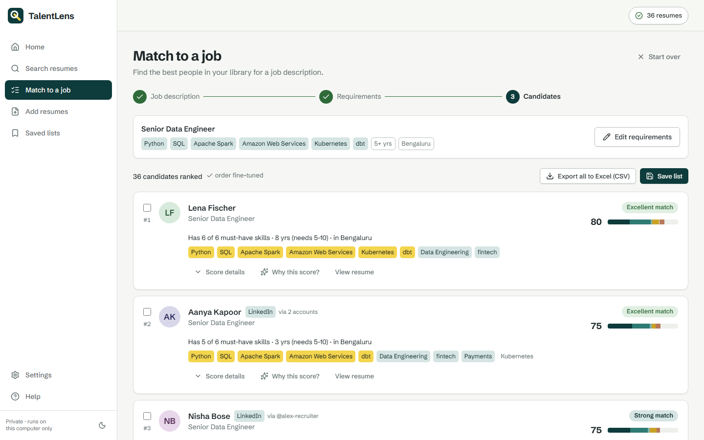

# TalentLens setup manual

For anyone who received a TalentLens invite link and is installing the app from scratch. No technical knowledge needed.

| | |
|---|---|
| **[Setup guide (PDF, 11 pages)](TalentLens-Setup-Guide.pdf)** | Step-by-step booklet with screenshots: install, choose your resume folder, connect with your invite link, search, match a job, add resumes. |
| **[Setup video (MP4, about 3 minutes)](TalentLens-Setup-Video.mp4)** | The same walkthrough with on-screen captions (no sound). |



All people, companies and invite links shown are fictional. They come from a demo library and a mock team server, never from real data.

## Regenerating

The manual is generated from the running app, so it stays in step with the UI. From the repository root, with TalentLens closed (it needs port 8765) and Ollama running:

```bash
npx --prefix frontend playwright install chromium   # once
uv run python scripts/manual/make_manual.py          # video + screenshots + PDF (about 5 minutes)
uv run python scripts/manual/make_manual.py --no-video   # PDF only, from the existing screenshots
```

- `scripts/manual/scenes.mjs`: the steps, captions and booklet text. Edit the wording here.
- `scripts/manual/record.mjs`: the Playwright walkthrough (video + one screenshot per step).
- `scripts/manual/booklet.mjs`: builds the PDF.
- `scripts/manual/mock_team.py`: a stand-in team server with invented LinkedIn connections.
- `scripts/manual/make_manual.py`: runs it all in a throwaway profile, then trims the AI waiting time out of the video and converts it to MP4.
